 

### About

I build web, mobile and AI products end to end: the interface, the API, the data model and the automation around them. Most of my recent work sits where product engineering meets AI — retrieval over large document sets, agents that talk to real users, and pipelines that remove manual work from a team's day.

I care about contracts between layers, code that the next developer can change safely, and shipping things people actually use.

 

### Selected work

<table>
  <tr>
    <td width="50%" valign="top">
      <b>Legal AI search</b> 
      Retrieval over national and EU law with validity tracked per article, cited answers, and a lawyer review queue so no decision rests on an unverified external signal. 
      <code>FastAPI</code> <code>Qdrant</code> <code>NestJS</code> <code>MongoDB</code> <code>React 19</code>
    </td>
    <td width="50%" valign="top">
      <b>Payroll & HR platform</b> 
      Frontend for an HR ERP built against API contracts and mocks, so connecting the real backend touched one file per feature. Pension and tax bases made auditable on the payslip. 
      <code>React 19</code> <code>TanStack Router</code> <code>React Query</code> <code>Vitest</code> <code>MSW</code>
    </td>
  </tr>
  <tr>
    <td width="50%" valign="top">
      <b>Invoice processing pipeline</b> 
      OCR extraction, AI classification of ambiguous fields and automatic upload to sheets. About 60% less operational load, running without supervision. 
      <code>n8n</code> <code>Claude</code> <code>Google Vision</code>
    </td>
    <td width="50%" valign="top">
      <b>WhatsApp support agent</b> 
      Conversational agent with context, voice and human escalation. Response time went from hours to seconds; human workload down 70%. 
      <code>n8n</code> <code>OpenAI</code> <code>ElevenLabs</code> <code>NestJS</code>
    </td>
  </tr>
</table>

### Projects

<table>
  <tr>
    <td width="50%">
      
      
<a href="https://github.com/ivancidev/skillstudio">Code</a> · <a href="https://skillstudio-kappa.vercel.app">Live</a>

    </td>
    <td width="50%">
      
      
<a href="https://github.com/ivancidev/prepai">Frontend</a> · <a href="https://github.com/ivancidev/prepai-back">Backend</a>

    </td>
  </tr>
  <tr>
    <td width="50%">
      
      
<a href="https://github.com/ivancidev/doqify">Code</a> · <a href="https://doqify.vercel.app">Live</a>

    </td>
    <td width="50%">
      
      
<a href="https://github.com/ivancidev/cvearly">Code</a> · <a href="https://cvearly.vercel.app">Live</a>

    </td>
  </tr>
  <tr>
    <td width="50%">
      
      
<a href="https://github.com/ivancidev/worldcup-ai-predictor">Code</a> · <a href="https://worldcup-ai-predictor-sage.vercel.app">Live</a>

    </td>
    <td width="50%">
      
      
<a href="https://github.com/ivancidev/n8n-ai-automations">Code</a>

    </td>
  </tr>
</table>

<b>More projects</b>

 

| Project | What it is | Stack |
|:--|:--|:--|
| [webTime](https://github.com/ivancidev/webTime) · [live](https://web-time-seven.vercel.app) | Audiobook platform for learning web programming | `React` `Node.js` |
| [useTeam Kanban](https://github.com/ivancidev/useTeam-kanban-challenge) · [live](https://use-team-kanban-challenge.vercel.app) | Real-time Kanban board for teams | `Next.js` `NestJS` `WebSockets` |
| [workBoardAgile](https://github.com/ivancidev/workBoardAgile) · [live](https://work-board-agile.vercel.app) | Agile project management with visual boards | `React` `TypeScript` |
| [x-clone](https://github.com/ivancidev/x-clone-twitter) · [live](https://x-clone-twitter-murex.vercel.app/) | X/Twitter clone, frontend and [backend](https://github.com/ivancidev/x-clone-backend) | `Next.js` `NestJS` |
| [gta6-landing](https://github.com/ivancidev/gta6-landing-clone) · [live](https://gta6-landing-clone.vercel.app) | Landing recreation with scroll-driven animation | `Astro` `GSAP` `Lenis` |
| [ApiRest NestJS](https://github.com/ivancidev/ApiRest-con-Nestjs-TypeORM-Docker-y-PostgreSQL) | Containerized REST API | `NestJS` `TypeORM` `Docker` |
| [ivancidev-blog](https://github.com/ivancidev/ivancidev-blog) · [live](https://ivancidev-blog.vercel.app) | Developer blog | `Astro` |

 

### Stack

   
  

  
  
  
  
  
  
  
  

 

### Activity

  
  

  <picture>
    <source media="(prefers-color-scheme: dark)" srcset="https://raw.githubusercontent.com/ivancidev/ivancidev/output/github-snake-dark.svg"/>
    
  </picture>

